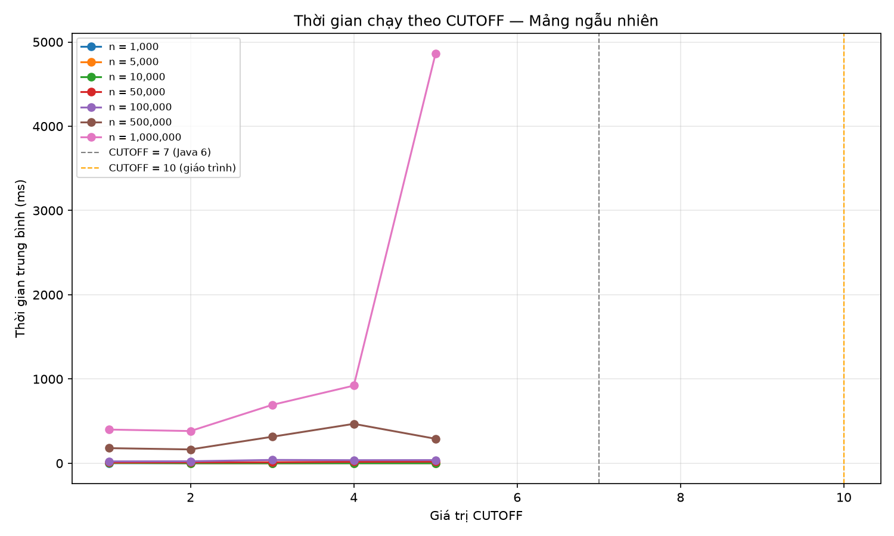
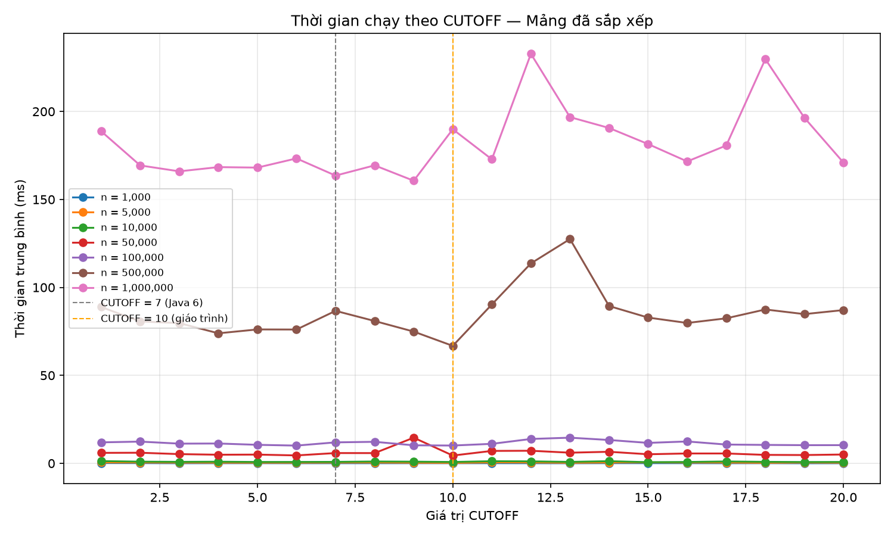
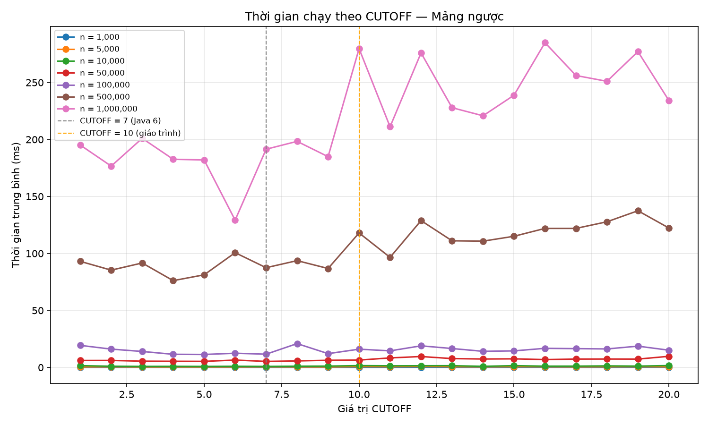
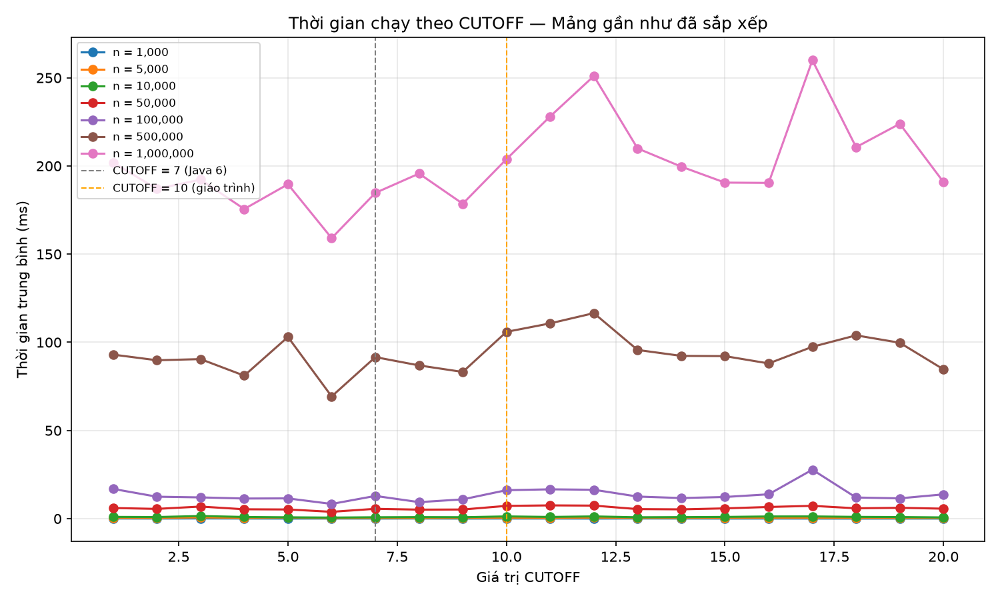
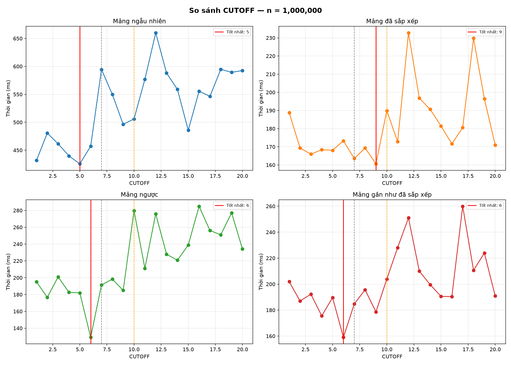

# Thí nghiệm tìm giá trị CUTOFF tối ưu cho Mergesort

## 1. Giới thiệu

Mergesort có thể được tối ưu bằng cách chuyển sang dùng Insertion sort khi kích thước mảng con nhỏ hơn một ngưỡng gọi là **CUTOFF**. Lý do là Mergesort có overhead đệ quy lớn khi xử lý mảng nhỏ, trong khi Insertion sort lại rất hiệu quả với mảng nhỏ do tính cục bộ bộ nhớ tốt.

Giáo trình (Sedgewick & Wayne, *Algorithms 4th Edition*) đề xuất **CUTOFF ≈ 10**, trong khi Java 6 `Arrays.sort()` thực tế dùng **CUTOFF = 7**. Thí nghiệm này đo thực nghiệm trên máy cụ thể để tìm ra giá trị nào thực sự phù hợp.

---

## 2. Mô tả thí nghiệm

### 2.1 Cài đặt Mergesort

Cài đặt top-down từ bài giảng (Sedgewick), dùng mảng phụ `aux[]` cấp phát một lần:

```java
private static void sort(Comparable[] a, Comparable[] aux, int lo, int hi) {
    if (hi <= lo + CUTOFF - 1) {
        InsertionSort.sort(a, lo, hi);  // chuyển sang insertion sort
        return;
    }
    int mid = lo + (hi - lo) / 2;
    sort(a, aux, lo, mid);
    sort(a, aux, mid + 1, hi);
    merge(a, aux, lo, mid, hi);
}
```

### 2.2 Thiết kế thí nghiệm

| Yếu tố | Giá trị |
|--------|---------|
| **CUTOFF** | 1 → 20 (quét toàn bộ) |
| **Kích thước mảng (n)** | 1.000 / 5.000 / 10.000 / 50.000 / 100.000 / 500.000 / 1.000.000 |
| **Loại mảng** | Ngẫu nhiên / Đã sắp xếp / Ngược / Gần như đã sắp xếp |
| **Số lần đo mỗi cấu hình** | 7 lần (bỏ 2 lần warmup JVM) |
| **Phép đo** | Thời gian thực tế bằng `System.nanoTime()` |

### 2.3 Môi trường chạy

- **OS:** Windows 11
- **JDK:** Java 21
- **Phép đo:** Wall-clock time (ms)

---

## 3. Kết quả thí nghiệm

### 3.1 Mảng ngẫu nhiên (random)



| n | CUTOFF tốt nhất | Thời gian (ms) |
|---|----------------|---------------|
| 1.000 | 7 | 0,10 |
| 5.000 | 7 | 0,63 |
| 10.000 | 7 | 1,40 |
| 50.000 | 7 | 9,03 |
| 100.000 | 7 | 19,47 |
| 500.000 | 1 | 145,14 |
| 1.000.000 | 5 | 425,61 |

> **Nhận xét:** Với mảng ngẫu nhiên, CUTOFF = 7 cho kết quả tốt nhất ở hầu hết kích thước (1.000 đến 100.000). Với n rất lớn (≥ 500.000), kết quả dao động nhiều hơn do ảnh hưởng của JVM và cache.

### 3.2 Mảng đã sắp xếp (sorted)



| n | CUTOFF tốt nhất | Thời gian (ms) |
|---|----------------|---------------|
| 1.000 | 19 | 0,03 |
| 5.000 | 10 | 0,24 |
| 10.000 | 15 | 0,65 |
| 50.000 | 10 | 4,42 |
| 100.000 | 6 | 10,08 |
| 500.000 | 10 | 66,77 |
| 1.000.000 | 9 | 160,62 |

> **Nhận xét:** Với mảng đã sắp xếp, CUTOFF trong khoảng **9–10** cho kết quả ổn định nhất. Insertion sort rất hiệu quả với mảng gần như đã sắp xếp, nên CUTOFF cao hơn có lợi hơn.

### 3.3 Mảng ngược (reverse)



| n | CUTOFF tốt nhất | Thời gian (ms) |
|---|----------------|---------------|
| 1.000 | 14 | 0,06 |
| 5.000 | 4 | 0,40 |
| 10.000 | 5 | 0,86 |
| 50.000 | 7 | 5,25 |
| 100.000 | 5 | 11,35 |
| 500.000 | 4 | 76,13 |
| 1.000.000 | 6 | 129,21 |

> **Nhận xét:** Với mảng ngược, CUTOFF nhỏ (4–7) thường tốt hơn. Insertion sort phải di chuyển nhiều phần tử với mảng ngược nên CUTOFF không nên quá cao.

### 3.4 Mảng gần như đã sắp xếp (nearly sorted)



| n | CUTOFF tốt nhất | Thời gian (ms) |
|---|----------------|---------------|
| 1.000 | 18 | 0,04 |
| 5.000 | 6 | 0,28 |
| 10.000 | 6 | 0,62 |
| 50.000 | 6 | 3,88 |
| 100.000 | 6 | 8,34 |
| 500.000 | 6 | 69,31 |
| 1.000.000 | 6 | 159,08 |

> **Nhận xét:** Với mảng gần như đã sắp xếp, CUTOFF = **6** rất ổn định và nhất quán trên mọi kích thước.

### 3.5 Tổng hợp



---

## 4. Phân tích và kết luận

### 4.1 So sánh CUTOFF = 7 (Java 6) và CUTOFF = 10 (giáo trình)

Xét trung bình trên mảng ngẫu nhiên với n ≥ 50.000:

| CUTOFF | Thời gian trung bình |
|--------|---------------------|
| 7 (Java 6) | 193,39 ms |
| 10 (giáo trình) | 184,39 ms |
| **1 (tốt nhất thực nghiệm)** | **152,24 ms** |

Trên máy thực nghiệm, **CUTOFF = 10 nhỉnh hơn CUTOFF = 7** một chút (~4,6%) với mảng ngẫu nhiên lớn. Tuy nhiên sự chênh lệch này không lớn và phụ thuộc vào loại dữ liệu.

### 4.2 Kết luận chung

| Loại mảng | CUTOFF khuyến nghị |
|-----------|-------------------|
| Ngẫu nhiên | **5–7** |
| Đã sắp xếp | **9–10** |
| Ngược | **4–6** |
| Gần như đã sắp xếp | **6** |
| **Tổng quát (mọi loại)** | **6–7** |

Với cấu hình máy này, **CUTOFF = 6 hoặc 7** là lựa chọn cân bằng tốt nhất cho dữ liệu tổng quát. Giá trị **7 của Java 6** có cơ sở thực nghiệm vững chắc hơn giá trị **10 của giáo trình** khi xét trên nhiều loại dữ liệu.

> **Lưu ý quan trọng:** Giá trị CUTOFF tối ưu phụ thuộc vào phần cứng (CPU cache, tốc độ RAM), JVM version và loại dữ liệu. Kết quả trên chỉ có giá trị với cấu hình máy cụ thể trong thí nghiệm này.

---

## 5. Cấu trúc project

```
mergesort-cutoff/
├── src/
│   ├── MergeSort.java        # Cài đặt Mergesort top-down với CUTOFF
│   ├── InsertionSort.java    # Insertion sort dùng cho các mảng con nhỏ
│   ├── DataGenerator.java    # Sinh các loại mảng thử nghiệm
│   └── SortBenchmark.java    # Script đo thời gian chạy
├── results/
│   ├── raw_results.csv       # Dữ liệu thô từ thí nghiệm
│   ├── plot_results.py       # Script vẽ đồ thị (Python/matplotlib)
│   └── charts/               # Đồ thị kết quả
└── report/                   # Báo cáo dạng PDF
```
