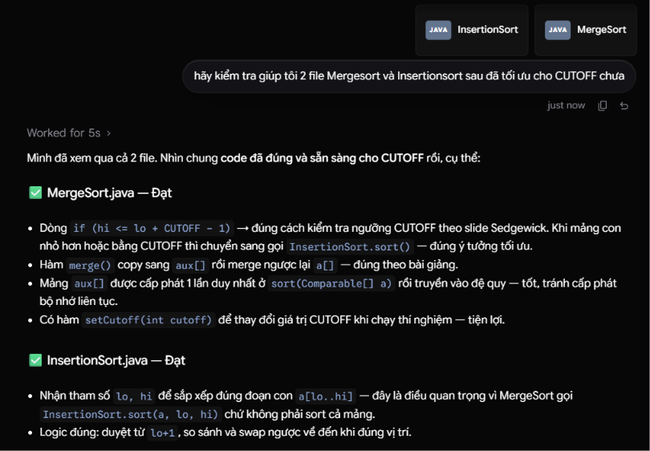
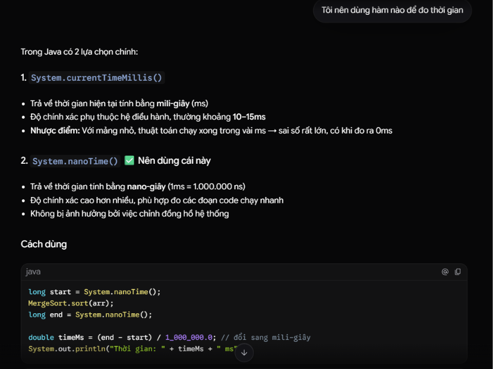
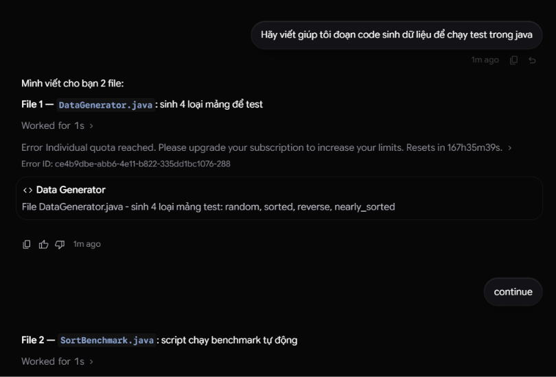
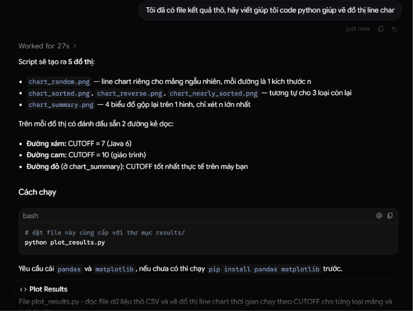
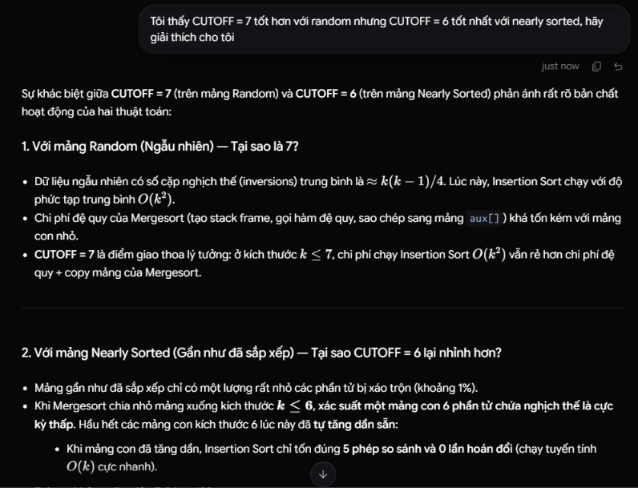
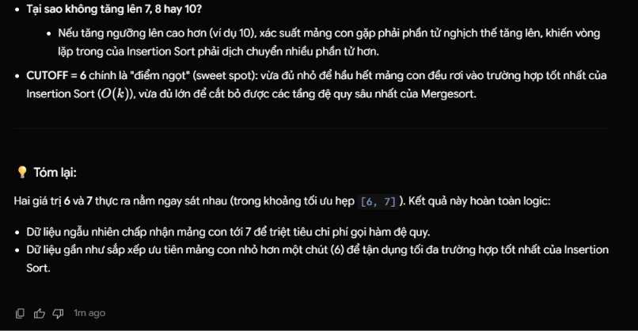
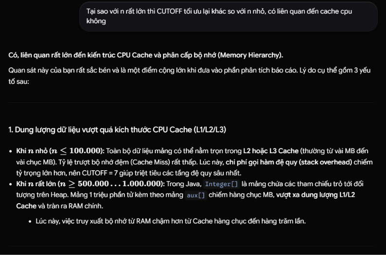
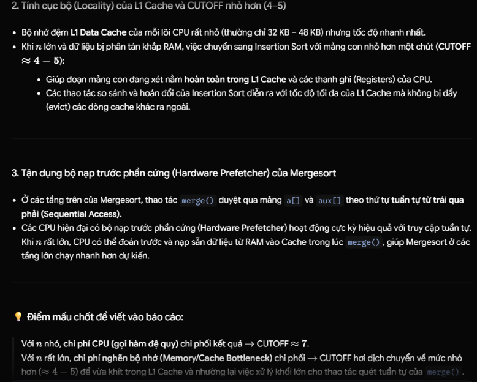

# Log chat với AI — Thí nghiệm Mergesort CUTOFF

Ghi lại các lần dùng AI hỗ trợ trong quá trình làm thí nghiệm.

---

## 1. Kiểm tra cài đặt MergeSort và InsertionSort

Trước khi chạy thí nghiệm, nhờ AI xem qua 2 file code để chắc chắn đã cài đúng phần CUTOFF.

---

## 2. Hỏi cách đo thời gian chạy trong Java

Không chắc nên dùng `currentTimeMillis` hay `nanoTime`, hỏi AI để chọn cái phù hợp hơn.

---

## 3. Nhờ viết code sinh dữ liệu test

Nhờ AI viết phần sinh mảng test (random, sorted, reverse, nearly sorted) và script benchmark để tập trung vào phần cài đặt thuật toán chính.

---

## 4. Nhờ viết code Python vẽ đồ thị

Sau khi có file dữ liệu thô, nhờ AI viết script vẽ line chart để trực quan hóa kết quả.

---

## 5. Hỏi về sự khác biệt CUTOFF giữa các loại mảng

Thấy kết quả CUTOFF = 7 tốt nhất với mảng random nhưng CUTOFF = 6 lại tốt nhất với nearly sorted, hỏi AI giải thích tại sao.

---

## 6. Hỏi tại sao CUTOFF tối ưu thay đổi khi n lớn

Nhận thấy với n rất lớn thì CUTOFF tối ưu khác với n nhỏ, hỏi AI xem có liên quan đến cache CPU không.

